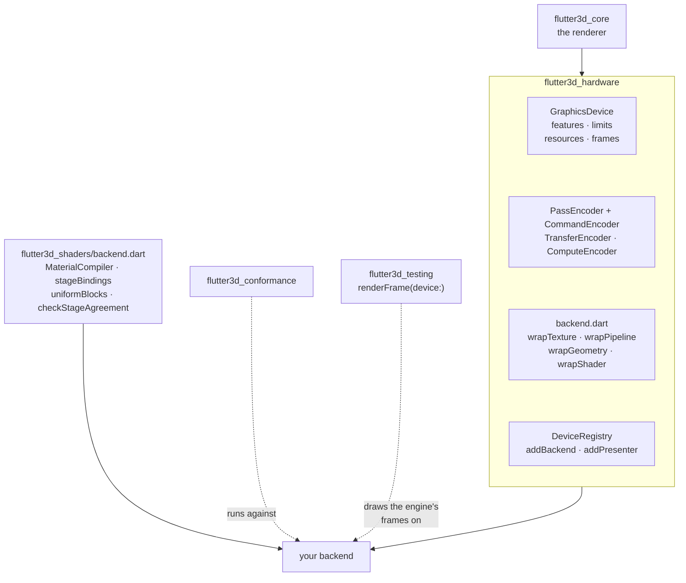

# Writing a HAL backend

`flutter3d_hardware` is a hardware abstraction layer with no implementation in it. Four packages implement it (Impeller through Flutter GPU, WebGL2, WebGPU and a software rasteriser), and this page is what you need to write the fifth: Vulkan or Metal through FFI, Direct3D, a headless server renderer.

**You write it in your own package, against published libraries, without a fork.** That is a promise the engine's own repository proves on every run: `examples/flutter3d_backend_null` is a backend written as you would write yours, depending on each engine package by path, importing nothing from another package's `src/`, and passing the conformance suite in CI. A structure rule refuses it the first private import.

The complete reference, every member and what may grow in a minor, is [`HAL.md`](https://github.com/pleiondev/flutter3d/blob/main/packages/flutter3d_hardware/HAL.md) in the hardware package.

What could **not** be written from the device contract alone is the shaders. That limit is real, and since 1.0 it has a contract of its own: [the last section on this page](#the-shader-contract).

<div class="goal">
<ul>
<li>Where to start: the null backend, and <code>flutter3d create plugin --kind backend</code></li>
<li>What <code>GraphicsDevice</code>, <code>PassEncoder</code> and <code>CommandEncoder</code> require, and what they give you with a body</li>
<li>The semantics that are part of the contract and appear in no signature</li>
<li>The conformance suite, in tiers, and how a check declines</li>
<li>The engine's frames on your device, from a test</li>
<li>The material compiler, and the shader contract a bundle answers to</li>
</ul>
</div>

## Start from the null backend {#start}

```bash
dart run flutter3d_build:flutter3d create plugin --kind backend --name flutter3d_vulkan
```

writes the null backend under your package's name: `VulkanDevice`, `VulkanPass`, `registerVulkanBackend`, `VulkanMaterialCompiler`, and two tests. As written it has no GPU. It keeps textures in memory, clears, uploads, overwrites, copies and reads them back, and refuses every pipeline at its first draw, so the engine's renderer runs on it and each pipeline a frame draws with is reported refused, once. It passes every conformance check but the shader tier on the day it is created, and you grow it into your backend one capability at a time, with the suite telling you which answer is still wrong.

The template is the example, file for file: a test in `flutter3d_build` compares them, so the backend you start from is the one CI holds to conformance.



## One way to open a device {#open}

Every backend opens the same way: asynchronously, at the size of the surface it starts with.

```dart fragment
final class VulkanDevice extends GraphicsDevice {
  static Future<VulkanDevice> open({required int width, required int height}) async {
    // ... create the instance, the device, the queue
  }
}
```

That shape is `BackendOpener`, and it is the only one the engine knows. `DeviceRegistry.addBackend` takes it, `flutter3d_testing`'s `renderFrame(device:)` and `testReplay(device:)` take it, and `runDeviceConformance(makeDevice:)` takes it. A backend that sizes its targets per frame takes the size and is not held to it; one that cannot (a canvas, a swapchain) draws at it.

Your package adds itself to an engine's registry with a function of its own, which an application calls:

```dart
import 'package:flutter3d/flutter3d.dart';
import 'package:flutter3d_shaders/backend.dart';

Registration registerVulkanBackend(
  DeviceRegistry<Object> registry, {
  MaterialCompilerRegistry? compilers,
}) {
  final backend = registry.addBackend('Vulkan', VulkanDevice.open);
  final compiler = compilers?.register(const VulkanMaterialCompiler());
  return Registration(() {
    compiler?.cancel();
    backend.cancel();
  });
}
```

Last added, first tried: an application that registers yours after the engine's own makes it the preferred backend, without editing `flutter3d_app`. The registry is the engine's, not a global, so two engines in one isolate choose backends of their own. A backend that shows its frames in a widget adds a presenter for its device type with `registry.addPresenter<VulkanDevice>(…)`, in `flutter3d_app`'s `FramePresenter` shape; a headless one adds none.

## The device: what has a body and what does not {#device}

`GraphicsDevice` is an `abstract base class`, implementable outside this repository and promised to stay so through 1.x. Its members split in two, and the split is the point of the 1.0 contract:

- **The members without a body** are the ones every backend has: the formats (`defaultColorFormat`, `defaultDepthStencilFormat`, `hdrColorFormat`), `framebufferOrigin`, `depthRange`, `preferredSampleCount`, `features`, `limits`, `textureFormatSupport`, `shaders` and `loadShaders`, the texture, geometry and pipeline creators, `beginFrame`, `onFrameComplete`, `beginRenderPass`, `readback`, the releases and `dispose`. They will not compile until they are all there, which is the one part of the contract that needs no reading.
- **Every feature-gated member has a body** that refuses with the feature named: compute, storage buffers, queries, transfers, render bundles, shared textures and fences, mapped buffers, multiview. You override a member when you implement it and add its feature to `features`; until then the default is your answer. **A new member arrives in a minor with a body**, so a backend written against 1.0.0 keeps compiling against every 1.x.

`PassEncoder`, `TransferEncoder` and `ComputeEncoder` follow the same rule. A pass implements the state setters, the binds, `clearBindings`, `draw` and `submit` (from the `CommandEncoder` mixin); the indirect draws, storage bindings, the blend constant, uniform bytes, debug groups and the rest have default bodies. The null backend's pass is the whole of what you must write.

### Capabilities are a set {#features}

`features` is a `DeviceFeatures` set of `DeviceFeature` constants, and `limits` a `DeviceLimits`. There are no `supportsX` getters: the engine asks `features.has(DeviceFeature.stencil)`, and a call that needs one you lack throws `UnsupportedCapabilityException` naming it. `DeviceFeature` is an open class, not an enum, so a minor that adds a feature breaks no `switch` of yours.

**Answer honestly, in both directions.** The conformance suite walks every feature: one you report must work when its probe calls it, and one you do not report must be refused *by that feature's name*, not by another one and not by doing it anyway. A device that can do something and does not say so is reported as dishonest too, because the engine will take the slower path for nothing. Inside your device, `refuse(feature)` builds the refusal; inside a pass, `device.features.require(feature, backend: name)` throws it.

| Answer | What answering wrong costs |
|---|---|
| `hdrColorFormat` | An **incomplete framebuffer**: every draw silently discarded, a frame of transparent black, every counter reporting success. WebGL2 accepts `RGBA16F` as a texture and refuses to render to it until `EXT_color_buffer_float` is asked for |
| `framebufferOrigin` | Maps the lighting pass looks into are flipped. The *picture* is fine, which is what makes it hard to find |
| `depthRange` | Geometry clipped against the near plane, or half of it gone |
| `DeviceFeature.manualMipmaps` | Not a slower texture, a **black** one: on OpenGL ES 2 without `GL_APPLE_texture_max_level`, a hand-built chain samples as black |
| `DeviceFeature.wireframe` | OpenGL ES has no `glPolygonMode`. Filling the triangles instead looks exactly like the wireframe setting having no effect |
| `preferredSampleCount` | One number instead of a boolean, because "does MSAA work" and "how much" are different questions |
| `limits.maxSamplerAnisotropy` | The one limit whose overshoot is *clamped* rather than refused: forward it unclamped to WebGL2 and every bind above the ceiling is `INVALID_VALUE`, silently |
| `limits.maxColorAttachments` | A pass past it is **refused**, not clamped: call `descriptor.checkAttachmentLimit` and `descriptor.checkFeatures` on the way into `beginRenderPass`, as every backend does |
| `DeviceFeature.stencil` | The x-ray stage draws nothing where it is absent, which is the intended answer. Claim it and leave the test unimplemented and the silhouette is drawn over the geometry it was meant to be clipped by |
| `DeviceFeature.renderToMipLevel` | The probe chain. flutter_gpu attaches a mip below the base on Metal and Vulkan and nowhere else, so it is a runtime answer, not a compile-time one |
| `textureFormatSupport` | A compressed texture the driver cannot sample. Answer yes and the upload succeeds and the surface is noise; answer no and the format is left out with a warning that names it. A family's feature (`textureCompressionBC`) must agree with the per-format table, which the suite checks |

<div class="warn">
<p><strong>Refuse loudly rather than substituting something similar.</strong> Every silent substitution on this list has cost somebody a day, because the failure mode is a plausible picture.</p>
</div>

### Handles come from `backend.dart` {#handles}

A handle's constructor is private since 1.0, so code that draws cannot make a texture or a pipeline that no device made. Your device wraps its own objects with the constructors in `package:flutter3d_hardware/backend.dart` (`wrapTexture`, `wrapGeometry`, `wrapPipeline`, `wrapShader`, `wrapStorageBuffer`, `wrapQuerySet`, `wrapFence`), naming itself as the owner so that a handle's `dispose` comes back to your `release…`, and calls `debugCheckLive` before handing a handle it was given to its API. That library is part of the package's snapshot and follows the same strict semver: a constructor there gains only optional parameters within a major.

**A handle is disposed exactly once.** A second dispose, and a handle used after its owner gave it back, fail in debug builds with the operation named; `DeviceLoss` on `lost` is how a backend tells the engine every handle is spent.

## Resources, frames and passes

```dart
/// Expensive: it compiles and links. Callers cache, keyed on the pair and on
/// the layout. A null [layout] means: work it out from the shader.
PipelineHandle createPipeline(ShaderHandle vertex, ShaderHandle fragment,
    {VertexLayoutDescriptor? layout});

/// Geometry that outlives the frame. [usage] is required and cannot be
/// defaulted: see the semantics below.
GeometryBuffer uploadGeometry(ByteData bytes, GeometryUsage usage);

/// One call rather than create-then-write. Refused with a
/// `DeviceResourceException` when [pixels] is not the size the format says,
/// and [mipLevels] are supplied, never generated: `MipChain.build` makes
/// them once, above the seam, so every backend samples the same chain.
TextureHandle createTextureFromPixels({
  required int width,
  required int height,
  required TextureFormat format,
  required ByteData pixels,
  List<ByteData>? mipLevels,
});

/// From TextureAllocator, so RenderTargetPool takes the device directly.
TextureHandle createTexture(TextureDescriptor descriptor);

void beginFrame();
CommandEncoder beginRenderPass(RenderPassDescriptor descriptor);
Future<ByteData> readback(TextureHandle texture, {ScreenRect? region});
```

`PassEncoder` is the recording half and `CommandEncoder` adds `submit()`. The split is deliberate: a contributor drawing into somebody else's pass is handed a `PassEncoder`, so passing it an already-submitted pass is a type error rather than a comment warning about one.

`bindTexture` and `bindUniformBlock` answer a bool: false for a slot or block the stage does not declare, and they never throw for one. A backend with no reflection answers true. `bindPipeline` forgets every binding (uniform blocks, textures, vertex slots and the index buffer), even when the same pipeline is bound again.

A `GraphicsDevice` is **a value, never a global**. A backend cannot be a separate package while the core reaches into it, and a fake, the only way a pass's drawing is testable off a device, cannot displace a singleton.

## Presenting, and reading back {#presenting}

A device does not present. A backend registers a presenter for its device type with the engine's `DeviceRegistry`, and `presentFrame` in `flutter3d_app` looks it up: flutter_gpu wraps its texture as a `ui.Image`, WebGL2 hands over the canvas it drew into, and a headless backend registers nothing. The contract used to ask the device for a `ui.Image`, which was an Impeller shape wearing a neutral name: on WebGL2 the only route is `readPixels` into CPU memory and back onto the GPU, timed once at 17.7 ms against a 16.7 ms budget for the whole frame.

`readback` is how anything reads what a pass wrote: **as the passes submitted before the call left it, and without waiting for the GPU.** A pass submitted afterwards does not reach the answer, and the caller is not held up by a frame the GPU is still on. Rows come back from the top on every backend. What cannot be read (tile memory, a multisampled target, a cube, a region past the edge, a region of any format but the two eight-bit RGBA layouts, an sRGB twin of them) is refused with an `ArgumentError` by `readbackRegionOf`, once, for every backend; a whole texture in another format is converted, which `readbackConverts` decides. A backend asks those two helpers rather than deciding for itself, so which requests convert is the interface's decision. A backend that can read a buffer in the calling turn mixes in `SynchronousBufferReadback`; a caller reaches it through `testing.dart`, since the main library offers no stall.

flutter_gpu 3.47 also offers a `GpuImageSurface`, and `presentFrame` does not use it for a measured reason: `packages/flutter3d_impeller/tool/surface_probe.sh` runs the same clear through the renderer's ring of finished frames and through a surface, and the two cost the same UI-thread time (95 to 105 µs a frame) while the surface's pool is paced by the garbage collector, peaking at forty-seven textures where the ring holds two. The verdict is ARCHITECTURE §15.

## The semantics no signature can express {#semantics}

Half of what a backend must *do* is in no signature. These were prose once, which is to say they were unenforced, and three of them were broken in the second backend, each producing a correct-looking frame with the wrong content.

| Rule | What breaks when you get it wrong |
|---|---|
| **A clear covers the whole attachment**, whatever the viewport or scissor say | The point-light atlas clears once and then draws tile by tile. GL does not give this for free: `clearBufferfv` respects `SCISSOR_TEST` |
| **Rectangles are stated from the top left**, matching where row zero of a render target is | A backend whose framebuffer origin is at the bottom must flip them. The engine will not |
| **`readback` returns rows from the top**, independently of the above | A caller cannot tell which way round it was handed pixels, and a golden compared against a mirrored frame fails as though rendering broke |
| **`readback` returns the frame before**: the texture as the passes submitted before the call left it, without stalling | A copy made when the driver gets round to it hands an exposure meter the frame *after*; the check clears red, asks, clears blue, and has to get red |
| **A sampler a shader declares must be bound** | Leaving one unbound is a native crash with no Dart frame on at least one backend, which is why the engine binds a stand-in rather than nothing |
| **`bindUniformBlock` returns false for a block the shader does not have** | That case is ordinary: a compiler drops a block nothing reads. A block that exists *without a member the caller named* is an error, because then the two ends disagree about its shape |
| **A null `sampler` means `SamplerDescriptor.linearRepeat`**, not the constructor's own defaults, which are nearest and clamp | The two hardware backends agreed on this without anybody writing it down; the third took the constructor defaults and drew hard seams on two percent of every textured golden |
| **`GeometryUsage` is not a hint** | WebGL binds a buffer to its target for life. A buffer uploaded as vertices can never be bound as indices: `INVALID_OPERATION`, the draw is dropped, and the frame comes back the clear colour with nothing logged |
| **`setDepthWrite(false)` means depth writes are off** | flutter_gpu's setter ignored its argument until SDK 3.47, and additive particles occluded each other. The software backend mirrored the bug while it stood, because comparable beats correct when two backends are held to one golden set |
| **Unset `PassState` fields mean *emit nothing*** | What an omitted call means differs per backend, and the omissions in a pass's sequence are load-bearing |
| **`bindPipeline` forgets every binding** | A draw that missed a bind reads the previous draw's and draws a plausible picture, on the one backend that kept it, while the others fail |
| **A pipeline your API will not build is reported, never thrown from a draw**: `device.pipelineRefusals.report(handle, PipelineRefusedException(...))`, skip the draw, build again at the next use while `report` answers true, and skip every draw once `isRefused` says so | A lazily linking GLES driver refused one pair at its first draw, the throw went through the renderer, and that one pair failed every frame of the application. A refusal no rebuild can change passes `retry: false`; the null backend reports every pipeline that way |
| **Enum and constant names are load-bearing** | The Impeller backend's translation asserts that each value maps to the flutter_gpu value of the same name, which is what catches a mapping that swapped two entries |

### Which way Y points {#y-axis}

**WebGL2 counts rows from the bottom; Impeller (Metal), WebGPU and the software rasteriser count them from the top.** A backend says which it is through `framebufferOrigin`. The picture comes out upright on every one of them; what differs is where row zero of a render target sits, and so what `gl_FragCoord.y`, a texture's `v` and a velocity's green mean.

| Where it shows | Top-left backends | WebGL2 (bottom-left) | Rule |
|---|---|---|---|
| `gl_FragCoord.y` | 0 at the top of the picture | 0 at the bottom | A **screen-space pattern** (Bayer dither, grain, a ray march's jitter, a shadow kernel's rotation) reads `FragCoordFromTop(rows)` from `lib/frag_coord.glsl`, so the pattern lands on the same pixels everywhere |
| Reading back a texture the same backend drew at this pixel | `gl_FragCoord` | `gl_FragCoord` | **Never flip.** The backend drew that texture into the same rows it is shading now |
| Velocity, stored as a difference of texture coordinates | green positive for motion down the picture | green positive for motion up it | Consumers read it in the same backend's coordinates and agree |
| Viewport and scissor rectangles | as given | the backend flips them | **Stated from the top left** in the contract |
| A cube face or an offscreen target sampled through a matrix | as is | y negated in the projection | The engine does this per origin; a backend only answers `framebufferOrigin` truthfully |
| `readback` | rows from the top | rows from the top (the backend flips them) | Top-first on every backend |

**Flip for patterns, never for lookups.** A pattern has to be the same on every screen; a lookup has to find the texel this backend just wrote at this pixel.

## Run the conformance suite {#conformance}

`flutter3d_conformance` turns those semantics into executable checks, and a backend is finished when they pass, not when it compiles.

```dart
import 'package:flutter3d_conformance/flutter3d_conformance.dart';

void main() => runDeviceConformance(
  backend: 'vulkan',
  makeDevice: VulkanDevice.open,
  // While the backend draws nothing yet: every check but the shader tier.
  checks: conformanceChecks.where((c) => !shaderChecks.contains(c)).toList(),
);
```

**The checks come in tiers, and `checks:` is the tier you have reached.** `coreChecks` works with clears, uploads and readback alone. The capability report, compute, multiview, sharing, field residence and the headset's views each have a list of their own, and each passes or declines on a device that does not draw. `shaderChecks` needs the bundle and a rasteriser: 33 shader checks against eight that ask for none, and one more for a backend that can pack its own shaders as a loadable bundle (`ownShaders:`), so 33 of the 57 link stages and draw. Among them: that a pass starts covering its own attachment and nothing else, that its initial viewport covers the *level* rather than the base, that it inherits no clipping from the pass before it and starts with the stencil test off, that a binding made for one pipeline does not follow the next, that a refused pipeline draws nothing while the rest of its pass draws and is told once, that a block missing a member the caller named is refused, that a blend constant reaches the blend or is refused rather than drawn as zero, that an object id survives the draw and the readback, and that wireframe and every primitive type are each drawn as themselves or refused. Leave `checks:` out and every check runs. The lists are the authority, and the counts in this paragraph are held to them by `tool/structure.dart`.

**A check a device cannot be asked declines, and a decline is never a pass.** Every check refuses to answer through one function, `decline(device, why)`, which throws `ConformanceDeclinedException` with your device's `backendName` at the front of the sentence; the runner reports it as skipped with that sentence. Multisampling declines on the software rasteriser, the blend constant on Impeller and WebGPU, the uniform-member rule on a backend that does not reflect its shaders. A check that once returned early on a missing feature was counted as a pass, which is the lie this rule exists to end: "the suite is green" and "the suite is green, and here is what it never asked" are different sentences.

**`makeDevice` may decline too.** A machine with no device for your backend at all (headless Chrome on a CI runner has `navigator.gpu` and hands out no adapter) throws `ConformanceDeclinedException` from the factory, and every check is skipped with its reason rather than failed.

The device factory is called **fresh for each check** and the device disposed after it, because a backend that leaves state behind should fail on its own account instead of on the previous test's. The suite uses its own `require` rather than `expect`, so the same list runs from an application where a backend has no test runner (Flutter GPU needs Impeller, which a headless `flutter test` does not enable): `conformanceChecks` is exposed as plain functions for that case.

## The engine's frames on your device {#testing}

`flutter3d_testing` draws the engine's frames on the software rasteriser by default, and on any device you name:

```dart
import 'package:flutter3d_testing/flutter3d_testing.dart';

final frame = await renderFrame(
  width: 320,
  height: 180,
  device: VulkanDevice.open,
  build: (request) => buildScene(request.device),
);
await expectMatchesGolden(frame, 'test/goldens/vulkan/crypt.png');
```

`renderFrame(device:)` opens the device at the frame's size, draws, reads the pixels and disposes it. `testReplay(device:)` and `expectReplayMatches(device:)` replay a tape and draw each golden on one device opened for the run. `drawOnce` is the layer under both for a test that keeps its own device and `Renderer`. A golden set drawn on your backend is your backend's: keep it in a directory of its own, because the same scene differs by a fraction of a percent between a rasteriser and a driver, and one shared set would need a tolerance.

## The material compiler {#materials}

A plugin's material is a `.f3dmat` source, and each backend turns it into its own section of a shader bundle. A backend says how by registering a `MaterialCompiler` (`package:flutter3d_shaders/backend.dart`) with the engine's `MaterialCompilerRegistry`; the build hook and `RuntimeShaders` both consult it by backend, so a fifth backend gets materials without a change to either.

```dart
final class VulkanMaterialCompiler extends MaterialCompiler {
  const VulkanMaterialCompiler();

  @override
  String get backend => 'vulkan';

  /// Your section of the bundle; no two backends may write the same one.
  @override
  String get bundleSection => 'vulkan';

  @override
  MaterialCompileResult compile(MaterialCompileRequest request) {
    // request.stages: the material as GLSL, one stage per entry point.
    // Compile each (compileStage below) and pack them as your device reads them.
  }
}
```

`compilesAtRunTime` says whether `compile` can run while a game runs, with no toolchain beside it; it is false by default, and what needs glslang or naga runs in the build only. `isSectionWrittenByBuild` says the build writes your section with a tool of its own rather than through `compile`, as Impeller's `impellerc` does. Your device's `loadShaders` reads the section back when it loads a bundle. The null backend's compiler writes the stage names and its device answers them, which is the whole round trip with the compiling taken out.

## The shader contract {#the-shader-contract}

**Shader names are the one thing the device contract cannot abstract.** The engine asks for entry points (`MeshVertex`, `Pbr`, `Composite`) and for uniform blocks and members by name, and nothing in any signature says which. An implementation written from the interface alone compiles and draws nothing: `Renderer.create` throws on the first name it cannot find. Since 1.0 that half has a contract of its own, in code and in CONTRACTS ("The shader ABI"):

- **`package:flutter3d_shaders/backend.dart`**: `stageBindings`, the uniform blocks and samplers each of the engine's stages keeps once compiled, which a draw must bind and may bind; `uniformBlocks`, every block's members, offsets and sizes as std140 laid them out; `MaterialCompiler` and `MaterialCompilerRegistry`; `StageInterface` and `checkStageAgreement`, the varyings, attributes and blocks two stages of a pipeline must agree on, checked before a bundle is written rather than discovered on one backend.
- **`package:flutter3d_shaders/compile.dart`**: `compileStage(glsl, name:, fragment:, target:)` compiles a stage to SPIR-V with glslang and, through naga, to a `ShaderTarget` (`spirv`, `wgsl`, `msl`, `hlsl`, `glsl`). It needs both tools on the machine.
- **CONTRACTS**: the entry points in full, and the `F3D_*` defines the engine's GLSL is compiled with, each set by the stage that includes the shared headers and never by a backend.

`requiredShaders` in `package:flutter3d_shaders/flutter3d_shaders.dart` is the list, kept in step with the bundle manifest by a test, and this table is kept in step with both by the `the site names every shader a bundle must answer to` rule:

| Stage | Names |
|---|---|
| Vertex | `MeshVertex`, `MeshSkinnedVertex`, `MeshInstancedVertex`, `MeshLightmappedVertex`, `FullscreenVertex`, `DebugLineVertex`, `ParticleVertex`, `ParticleMeshVertex`, `PolylineVertex`, `ShadowTileResetVertex`, `SkyVertex`, `SkyCubeVertex`, `SkyPhysicalVertex`, `ImpostorVertex`, `VelocityVertex`, `VelocitySkinnedVertex`, `VelocityInstancedVertex` |
| Lighting | `Unlit`, `Lambert`, `BlinnPhong`, `Pbr`, `Toon`, `Normals`, `PbrLayered`, `Impostor`, `PlanarReflection`, `UnlitOpaque`, `LambertOpaque`, `BlinnPhongOpaque`, `PbrOpaque`, `PbrLayeredOpaque`, `ToonOpaque`, `DepthPredraw` |
| Shadows | `ShadowDepth`, `ShadowDistance`, `ShadowDepthMasked`, `ShadowDistanceMasked`, `ShadowTileReset`, `EvsmFilter`, `ShadowCopy`, `ShadowTransmittance`, `CausticSurface`, `CausticPhotonVertex`, `CausticPhoton` |
| Post | `BloomThreshold`, `BloomDownsample`, `BloomUpsample`, `Composite`, `Fxaa`, `SmaaEdges`, `SmaaWeights`, `SmaaBlend`, `LensFlare`, `Reflections`, `Ssao`, `SsaoBlur`, `ContactShadow`, `ContactShadowResolve`, `Splat`, `LightShafts`, `DepthOfField`, `ViewportShade`, `OutlineMask`, `HighContrast`, `Luminance`, `ProbePrefilter`, `CameraVelocity`, `Velocity`, `VelocityTileMax`, `VelocityNeighborMax`, `MotionBlur`, `TemporalResolve`, `TemporalAccumulate`, `Reactive`, `Easu`, `LocalExposure`, `LocalExposureBlur`, `VolumetricFog`, `VolumetricFogUpsample`, `DepthPyramid`, `SceneColorCopy`, `WboitResolve`, `DofTileMax`, `Decal`, `RenderTextureEncode` |
| Particles | `Particle`, `ParticleTextured`, `ParticleMesh`, `ParticleSixWay`, `ReactiveSprite`, `SplatHashed`, `ParticleSoft`, `ParticleTexturedSoft`, `ParticleSixWaySoft` |
| Sky | `Sky`, `SkyCube`, `SkyPhysical` |
| Debug | `DebugLine`, `MrtProbe`, `ObjectId`, `Xray` |
| Probes | `VertexTextureProbeVertex`, `VertexTextureProbe`, `IrradianceConvolve`, `FieldDecay` |

105 shader entry points. A backend that computes answers to `computeShaders` too. The names are stable within a major: a minor may add one, never rename or drop one, and `stageBindings` and `uniformBlocks` follow the shaders, so a backend that binds by them follows a minor without a code change.

### If your API does not speak GLSL

WebGPU does not, and no browser takes SPIR-V, so `flutter3d_webgpu` is the worked example of the longer road: the same manifest through glslang and naga, with only the *declarations* of each stage edited. Three things about that road cost a day each, and all three produce a picture rather than an error.

- **naga turns a vertex stage over unless told not to.** Without `--keep-coordinate-space` it appends `gl_Position.y = -(gl_Position.y)` to every vertex entry point, and every scene comes back upside down. `compileStage` passes it.
- **naga will not read a combined sampler.** `uniform sampler2D tex` compiles to SPIR-V that `spirv-val` accepts and naga refuses with `invalid id %14`, naming neither a file nor a construct. Splitting the declaration into a `texture2D`, a `sampler` and a `#define` leaves every call site untouched.
- **WGSL requires uniform control flow for `textureSample`, and a browser reports one error per module.** Six of the engine's fragment stages sampled under a branch a quad need not take together, which naga accepts and a browser does not.

There is also no link step, which moves two decisions GLSL leaves to the linker. Reflection has to be **written by the packer**, because a module cannot be asked what it declares and a pipeline layout has to state it; that is what `stageBindings` is. And a **varying's location has to be decided across the manifest** rather than inside a file, because two modules compiled apart are joined by location alone; `checkStageAgreement` holds every pipeline's pair to it.

<div class="warn">
<p>Member names fail silently in <em>both</em> directions. A shader that asks for a member nobody wrote gets zeros; a caller that names a member the block does not have is an error. <code>flutter3d_cpu</code> hit the first on its first run: its shaders were written from a plausible memory of what a renderer's uniforms are called, and they drew an unlit scene with nothing anywhere reporting a problem. Bind by <code>uniformBlocks</code>, not by memory.</p>
</div>

## What is outside the promise

Not because it is unstable, but because nothing outside `flutter3d_hardware` should depend on it.

- Everything under another package's `src/`, and `flutter3d_shaders/internal.dart`. The structure rule that holds the null backend to published libraries holds yours to the same, if you copy it.
- `FrameResources` internals. Its rules (versions, `keeps`, release by identity) are engine machinery, and a backend never sees them.
- The compiled shader bundle's sections other than yours. Each is one backend's build output.

`PassState` and its `setState` extension are promised, and no backend implements anything for them: `setState` is an extension over `PassEncoder` built only from types already in the contract, so a backend gets it for free. They live in the HAL for the backend that accumulates rasteriser state and looks a pipeline up at `draw()`, which needs something hashable to accumulate into. `TextureHandle` deliberately has no `==`: the pool lends by identity and the frame releases by identity.

## A suggested order

1. `flutter3d create plugin --kind backend`. Run its tests: every check but the shader tier passes on the day it is created.
2. Replace the null device's memory with your API's resources: textures, geometry, `readback`. The core checks keep passing, now against your API.
3. Report each feature as you implement it. The capability check fails on one reported and not done, and on one done and not reported.
4. Compile the engine's stages for your API with `compileStage`, answer them from `shaders`, bind by `stageBindings`, and stop refusing pipelines in `draw`. Add `shaderChecks` to the conformance run.
5. Write your stages into your section in your `MaterialCompiler`, so a plugin's material reaches your device.
6. A presenter, if your backend shows frames in a widget, added in your `register…Backend`.
7. A golden set of your own through `renderFrame(device:)` and `testReplay(device:)`.

The third and fourth backends in this repository went through steps 2 to 6 by hand and said the same thing: the device is ordinary work, and the shaders are where the contract used to stop helping. Since 1.0 the shader half is a contract too.

## Next

- [Architecture](/core/architecture/#the-hal), where the HAL sits, and what the other rules are
- [The frame](/core/rendering/): what the engine will ask your backend to encode
- [Pitfalls](/reference/pitfalls/): the failure modes, arranged by what you see
- [Testing](/reference/testing/): the golden sets, and why there is more than one
